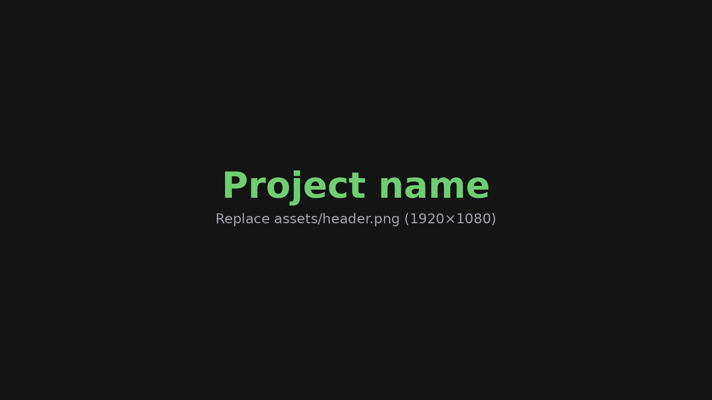

<!-- kapkit-starter: everything from here to "end of starter setup" is for setting up a new project. Delete it once you're done. -->

> [!IMPORTANT]
> **This is the kapKit starter.** Click the button to create a new project from it, then follow the steps below.
>
> 

<b>What to do next</b>

### 1. Start a new project

1. Click the **Deploy to Cloudflare** button above.
2. Sign in to Cloudflare, connect GitHub if it asks, then set the **Git repository name** and the **Worker name** (e.g. `kapkit-myapp`) and click **Create and deploy**. Cloudflare creates the repo on your GitHub, creates the Worker, and turns on Workers Builds.
3. Check branch previews are on: **Workers & Pages** → the new Worker → **Settings** → **Build** → **Branch control** → **Builds for non-production branches** is ticked.
4. Custom domain (optional): same Worker → **Settings** → **Domains & Routes** → **Add** → **Custom domain** → e.g. `myapp.kapkit.ca`.

### 2. Hook it up to preview-bot

1. Open <https://previewbot.kaplabs.ca> → **Add project** → type the Worker name. If the editor doesn't subscribe the build queue for you yet, follow the dashboard step in preview-bot's README ("Adding a project", step 1).
2. **Delivery & settings**: pick the Discord channel, set the display name, production URL and icon, then click **Save**.
3. Push a branch to the new repo. A **Preview Ready** message should arrive with the preview link.

### 3. Drop in your images

Replace these placeholders, keeping the file names:

| File | Used for | Size |
| --- | --- | --- |
| `assets/header.png` | Banner at the top of this README | 1920×1080 |
| `assets/cta-button.svg` | Green button under the intro; edit the label in the SVG | 218×54 |
| `public/favicon.png` | Browser tab icon and the project icon in preview-bot | 512×512 |
| `public/og-image.png` | Social share card in Discord, Slack, iMessage, X | 1920×1080 |
| `public/discord-preview.png` | preview-bot's preview image | Whatever preview-bot expects |

### 4. Fill in the placeholders

- In `public/index.html`, replace `Project name`, the description and `myapp.kapkit.ca` in the share-card tags (they need full URLs).
- In this README, replace `Project name`, the one-liner, `myapp.kapkit.ca`, `kapkit-myapp` and the sections below.
- In `docs/`, replace `kapkit-myapp` and `myapp.kapkit.ca`.
- Delete this setup section.

<!-- end of starter setup -->

# Project name

One line on what this is and who it's for.

 

 

**[How-To Guide](#how-to-guide)** · **[Report a Bug](https://github.com/sidkapahi/kapkit-myapp/issues)**

---

## Overview

A short paragraph on what it does and why someone would use it. Say what they need (and don't need) to get started.

> [!TIP]
> **✨ New features**
> - **Feature name**: one line on what it does
> - **Feature name**: one line on what it does

**What you get:**

- **Thing one**: what it shows or does
- **Thing two**: what it shows or does
- **Thing three**: what it shows or does

## How-To Guide

Nothing to install; it runs in the browser at **[myapp.kapkit.ca](https://myapp.kapkit.ca/)**.

### Before you start

What someone needs first: accounts, links, IDs.

### Get started

1. Open **[myapp.kapkit.ca](https://myapp.kapkit.ca/)**
2. Step two
3. Step three

## For Developers

Local dev and env vars are in **[docs/DEVELOPMENT.md](docs/DEVELOPMENT.md)**; how the site, branch previews and Discord build notifications deploy is in **[docs/DEPLOYMENT.md](docs/DEPLOYMENT.md)**.

> [!NOTE]
> **Built with [Claude Code](https://claude.com/claude-code), with security in mind.**
> One line on what data it touches (or doesn't). [PRs are very welcome](https://github.com/sidkapahi/kapkit-myapp/pulls)!

## License

[MIT](LICENSE) © Sid
